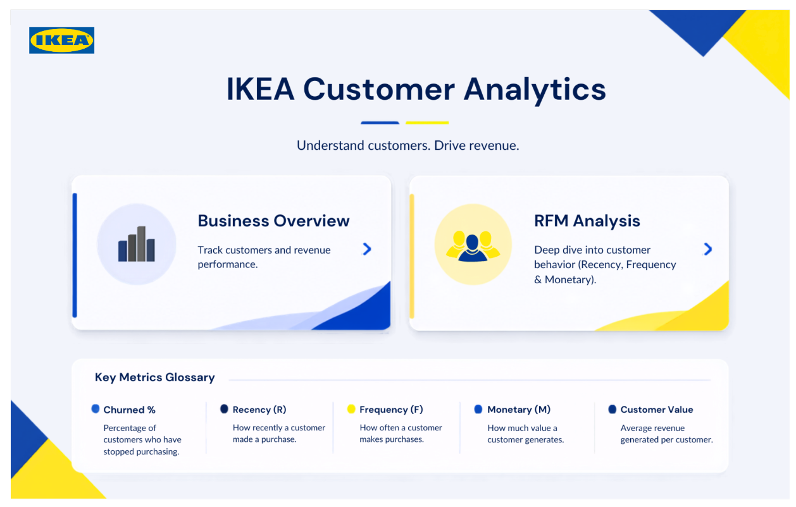

# IKEA Customer Analytics Dashboard

## 📌 Project Overview

This project is an interactive Power BI dashboard designed to analyse customer behaviour, revenue, customer segments, and churn. It helps turn raw data into meaningful insights that can support better business decisions.

The dashboard contains three pages: Home, Business Overview, and RFM Analysis.

*Note: This is a portfolio project and is not an official IKEA report.*

## 🎯 Project Objectives

- Understand customer purchasing behaviour.
- Analyse total customers and revenue.
- Identify different customer segments.
- Monitor customer churn over time.
- Compare customer behaviour across countries.
- Use RFM analysis to understand customer value.
- Present insights through an interactive dashboard.

## 🛠️ Tools Used

- **Power BI** — Dashboard creation, data visualisation, slicers, bookmarks, and navigation.
- **SQL, Excel** 

## 📊 Dashboard Pages

### 1. Home Page

The Home page is the starting point of the report. It contains navigation cards for Business Overview and RFM Analysis, along with a Key Metrics Glossary.

The navigation buttons allow users to move between report pages.

### 2. Business Overview

This page provides a summary of customer and business performance.

**Key metrics displayed:**
- Total Customers: 5,881
- Total Revenue: $17M
- Churned: 50.9%
- Average Customer Value: 2,954

**Visualisations include:**
- Total Customers by Segment
- Customer Relationship by Segment and Churn Status
- Total Customers by Month
- Total Customers by Quarter
- Total Customers by Year

These visuals help users compare customer segments and explore customer activity and churn over time.

### 3. RFM Analysis

RFM stands for **Recency, Frequency, and Monetary Value**.

- **Recency (R):** How recently a customer made a purchase.
- **Frequency (F):** How often a customer makes purchases.
- **Monetary (M):** How much a customer spends.

This page includes a country-level customer analysis table, Top 5 Countries by Average Customer Value, and churn percentage charts by month, quarter, and year.

It helps users explore customer purchasing patterns and compare customer value across countries.

## ⚙️ Key Features

- Interactive dashboard with three pages.
- KPI cards for important business metrics.
- Slicers for Month, Quarter, Year, Country, Segment, and IsChurned.
- **Power BI Bookmarks** to switch between Customer and Revenue views on the Business Overview page.
- Bookmarks to switch between Segment and Country views on the RFM Analysis page.
- Page navigation buttons for easy movement between dashboards.
- Clear All Slicers functionality to reset filters.

## 🔍 Key Observations

Based on the displayed dashboard:

- The report shows 5,881 customers and $17M in total revenue.
- The displayed churn percentage is 50.9%.
- Lost is the largest customer segment in the displayed segment chart.
- Customer counts vary across months and quarters.
- Average RFM scores differ across countries.

These observations help identify areas for further investigation. They do not, by themselves, explain why customers stop purchasing.

## 💡 Business Value

This dashboard demonstrates how data analytics can help a business:

- Monitor customer and revenue performance.
- Understand customer segments.
- Investigate customer churn.
- Compare customer behaviour across different periods and countries.
- Identify areas where customer retention strategies may be useful.
- Make more informed, data-driven decisions.

## 📁 Project Structure

```text
IKEA-Customer-Analytics/
│
├── README.md
├── IKEA_Customer_Analytics.pbix
│
├── screenshots/
│   ├── home.png
│   ├── business-overview.png
│   └── rfm-analysis.png
│
└── data/
    └── README.md
```

The folder and file names above are suggested examples. Include only files that are actually present in your repository and data that you are permitted to share.

## 🖼️ Dashboard Preview

### Home Page


### Business Overview


### RFM Analysis


## 📚 Skills Demonstrated

- Power BI dashboard development
- Data visualisation
- KPI reporting
- Customer segmentation
- RFM analysis
- Churn analysis
- Interactive slicers and filters
- Bookmark-based view switching
- Report page navigation
- Business-focused data storytelling

## 🏁 Conclusion

This project helped me practise presenting customer and business data in a clear, interactive format. By combining KPI cards, charts, filters, bookmarks, and multiple report pages, I created a dashboard that allows users to explore customer behaviour and business performance more easily.

**The goal is not just to display data, but to make the data easier to understand and use for better decisions.**
